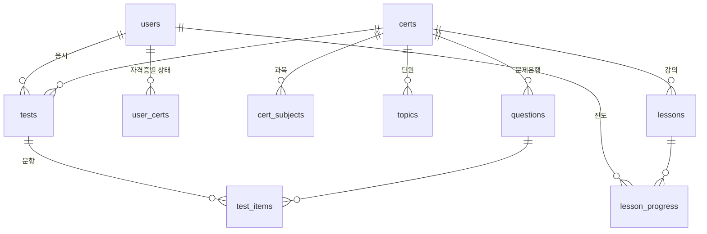

# PassLog DB 설계 문서

> 마지막 업데이트: 2026-10-10 · DB: MySQL/MariaDB `sqld` (utf8mb4_unicode_ci, InnoDB)
> 생성 SQL: `sql/schema.sql` · 변경/마이그레이션: `install.php` (몇 번 실행해도 안전)
> 접속: PDO, `ATTR_EMULATE_PREPARES=false`, 세션 `time_zone = '+09:00'`

## 1. ERD

## 2. 테이블 명세

### users — 회원
| 컬럼 | 타입 | 설명 |
|---|---|---|
| id | INT PK AI | |
| username | VARCHAR(20) UNIQUE | 로그인 아이디 (영문·숫자 4~20) |
| nickname | VARCHAR(20) UNIQUE NULL | 한글 2~10자. NULL 이면 로그인 후 닉네임 설정 화면으로 |
| email | VARCHAR(190) UNIQUE NULL | **[추후]** 이메일 로그인 키 |
| email_verified_at | DATETIME NULL | **[추후]** 이메일 인증 시각 |
| pass_hash | VARCHAR(255) | bcrypt (카카오 가입자는 아무도 모르는 임의 값) |
| kakao_id | VARCHAR(20) UNIQUE NULL | 카카오 회원번호. 카카오 로그인 연결 |
| plan | ENUM('free','premium') | **[추후]** 결제 요금제 |
| plan_expires_at | DATETIME NULL | **[추후]** 유료 만료 |
| created_at / last_login | DATETIME | |

### admins — 관리자 계정
| 컬럼 | 타입 | 설명 |
|---|---|---|
| id | INT PK AI | |
| username | VARCHAR(30) UNIQUE | 관리자 아이디 |
| pass_hash | VARCHAR(255) | bcrypt |
| pw_changed | TINYINT | 0 이면 초기 비밀번호 사용 중(경고 표시) |
| created_at / last_login | DATETIME | |

> certs · topics · questions · lessons 의 `admin_edited`(TINYINT) = 1 이면 관리자 수정본 → install.php 재실행 시 원본 JSON 으로 덮어쓰지 않음.

### login_attempts — 로그인 실패 기록
`ip`, `username`(소문자), `at`. 10분 창으로 제한 판단, 하루 지난 기록 자동 삭제.

### certs — 자격증
| 컬럼 | 설명 |
|---|---|
| code UNIQUE | sqld / eip / adsp / linux2 / net2 |
| name, short_name, org, description, exam_note, color, sort, active | 표시용 |
| minutes | 실제 시험 시간(분) → 문제당 시간 = minutes×60 ÷ 실전 문항 합 |
| pass_total | 합격 총점(100점 환산) |
| pass_subject | 과목 과락 기준 %, NULL = 과락 없음 |

### cert_subjects — 과목
`(cert_id, no)` UNIQUE, `name`, `exam_count`(실전 문항 수).

### topics — 단원(하부 카테고리)
`(cert_id, name)` UNIQUE, `subject`, `tip`(약할 때 공부 팁 → 분석 코멘트), `sort`.

### questions — 문제은행
| 컬럼 | 설명 |
|---|---|
| cert_id, code UNIQUE | 코드 예: `S2-101`, `EIP-3-012` |
| subject, topic | 과목 번호, 단원명(topics.name) |
| difficulty | 1 하 / 2 중 / 3 상 |
| question, code_block, choices(JSON 4개), answer(1~4), hint, explanation, mono, active | |
인덱스: `(cert_id, subject, difficulty)`, `(cert_id, topic)`.

### tests — 시험 1회
| 컬럼 | 설명 |
|---|---|
| user_id NULL / guest_key CHAR(64) NULL | 회원 또는 비회원(세션 토큰 sha256) |
| cert_id, test_date | |
| kind | `practice`(연습) / `exam`(실전 모의고사) |
| difficulty, subject_filter, topic_filter | 출제 조건 (NULL = 혼합/전체) |
| status | in_progress / done |
| started_at, finished_at, duration_sec | 걸린 시간(시간제한 시험은 문제별 시간 합 = 일시정지 제외) |
| q_seconds | 문제별 제한 시간(초), NULL = 시간 제한 없음 |
| cur_pos, cur_started_ts | 시간제한 시험의 현재 문제와 그 시작 unix time |
| paused_ts, pause_count, pause_total_sec | 일시정지 상태/횟수/누적 초 |
| total_cnt, correct_cnt, score, passed | 결과 |
| subject_json | 과목별 결과 `{"1":{"t":10,"c":7}}` |
| s1_total, s1_correct, s2_total, s2_correct | 예전 SQLD 기록 호환 |
| hints_used, timeouts | 힌트 사용 수, 시간 초과 문제 수 |
인덱스: `(user_id, status)`, `(user_id, cert_id, status)`, `(guest_key)`, `(test_date)`.

### test_items — 시험 문항
`(test_id, position)` UNIQUE, `question_id`, `user_answer`, `is_correct`, `hint_used/hint_used_at`, `answered_at`, `spent_sec`(문제별 소요 초), `timed_out`. FK: tests(CASCADE), questions.

### lessons — 강의 노트
`cert_id`, `code` UNIQUE(예 `EIP-L-3-02`), `subject`, `topic`, `sort`, `title`, `minutes`, `body`(마크다운), `active`.

### lesson_progress — 강의 진도 (PK user_id, lesson_id)
`status`(started/done), `read_pct`(가장 많이 읽은 %), `last_pct`(마지막 위치 % → 이어 읽기), `started_at`, `updated_at`, `completed_at`.

### user_certs — 회원 × 자격증 (PK user_id, cert_id)
`exam_date`(D-day), `last_lesson_id`(이어서 공부하기 기준).

### settings — 기타 key/value (현재 사용 거의 없음)

## 3. 마이그레이션 이력 (install.php 가 자동 수행)

| 날짜 | 변경 |
|---|---|
| 2026-10-03 | tests.uq_date 제거(하루 여러 번), tests.kind(daily/mock) 추가 |
| 2026-10-10 | users·login_attempts 신설, tests.user_id 추가(회원제), users.nickname |
| 2026-10-10 (v3) | certs·cert_subjects·topics·lessons·lesson_progress·user_certs 신설 / questions.cert_id / tests: guest_key·cert_id·difficulty·subject_filter·topic_filter·q_seconds·cur_pos·cur_started_ts·paused_ts·pause_count·pause_total_sec·subject_json·timeouts / test_items: spent_sec·timed_out / kind 값 daily→practice, mock→exam / 문항 수 컬럼 SMALLINT 확장 / users: email·email_verified_at·plan·plan_expires_at / settings 의 `u{id}:exam_date` → user_certs(SQLD) 이동 / 기존 문제·시험 → SQLD(cert) 연결 |
| 2026-10-17 | users.kakao_id (UNIQUE) 추가 — 카카오 로그인 |
| 2026-10-17 | admins 테이블 신설(관리자 계정), certs·topics·questions·lessons.admin_edited 추가(관리자 수정본 보호) |
| 2026-10-17 | (수동 1회) `sql/cleanup_legacy_accounts.sql` — kakao_id 없는 예전 계정과 그 기록 삭제. users.username / pass_hash 는 카카오 가입자용 내부 값으로만 사용 |

## 4. 데이터 보존 원칙
- 문제/강의는 `code` 기준 upsert → 내용 수정 후 install.php 재실행 시 덮어쓰기, 회원 기록 유지.
- 문제를 지우고 싶으면 삭제 대신 `active = 0` (기존 시험 기록의 FK 보호).
- 비회원 시험은 생성 후 2일이 지나면 새 비회원 시험 생성 시 정리됨. 로그인/가입 시 해당 세션의 비회원 시험은 회원 기록으로 이전.
