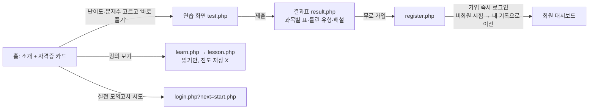
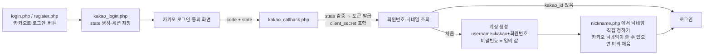
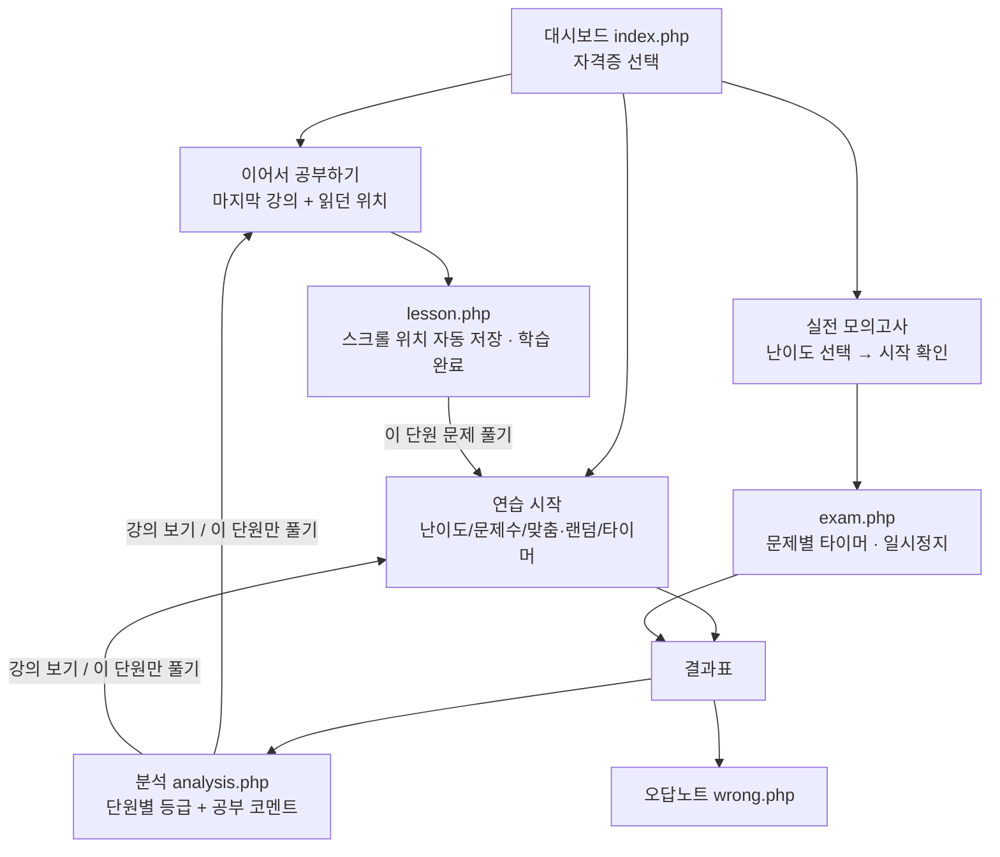

# PassLog(패스로그) 개발 스펙 문서

> 마지막 업데이트: 2026-10-10 · 버전 v3.0
> 대상: IT 자격증을 준비하는 수험생 (비전공자 포함) · 향후 결제(유료 요금제) 연동 예정 웹서비스
> 주소: `http://ryu.io.kr/sqld/` (폴더 이름은 호환을 위해 `sqld` 유지)

---

## 1. 서비스 개요

| 항목 | 내용 |
|---|---|
| 서비스명 | **PassLog (패스로그)** — "IT 자격증, 합격까지의 모든 기록" (임시 확정, `includes/core.php` 의 `BRAND_*` 상수로 한 번에 변경 가능) |
| 핵심 가치 | ① 실전과 같은 시험 환경(문항 수·시간·문제별 타이머·일시정지 기록) ② 약점 분석 + 맞춤 출제 ③ 단원별 강의 + 진도율 + 이어서 공부하기 |
| 자격증 | SQLD · 정보처리기사 필기 · ADsP · 리눅스마스터 2급 · 네트워크관리사 2급 필기 (5종) |
| 기술 스택 | PHP 8 (프레임워크 없음) · MySQL/MariaDB (PDO, 실제 prepared statement) · HTML/CSS · Vanilla JS · Three.js(배경) · Canvas 2D(차트) |
| 배포 | GitHub `tnwjd030207/my` main → EC2 `~/deploy.sh`(cron 1분) 가 pull → 배포 후 `install.php` 1회 실행(마이그레이션 + 데이터 등록) |

### 1-1. 브랜드 후보 (5개 추천)

| # | 이름 | 의미 / 톤 | 비고 |
|---|---|---|---|
| 1 | **PassLog 패스로그** (적용) | 합격(Pass) + 기록(Log). 기록·분석·진도가 강점인 서비스 성격과 일치 | 로고: 체크 표시가 그래프처럼 올라가는 마크 |
| 2 | 서티로드 CertiRoad | 자격증(Certificate) + 로드맵. 커리큘럼/진도 강조 | |
| 3 | 합각 HAPGAK | "합격각" 줄임말. 친근하고 젊은 톤 | 한글 도메인/짧은 이름 |
| 4 | 큐레벨 Q-Level | 문제(Q) + 레벨업. 난이도 선택·성장 강조 | |
| 5 | 잇패스 itPass | IT + Pass. 직관적, IT 자격증 전문 | 유사 상표 확인 필요 |

> 정식 오픈 전에 KIPRIS(특허정보검색)에서 상표 검색, 도메인 확보 여부를 꼭 확인할 것.

로고 파일: `assets/brand/logo.svg`(가로형), `assets/brand/mark.svg`(심볼), `assets/brand/favicon.svg`. 색상: 그라데이션 `#5eead4 → #8b5cf6 → #f472b6`, 배경 `#070a14`.

---

## 2. 사용자 유형과 권한

| 기능 | 비회원 | 회원(free) | 회원(premium, 추후) |
|---|---|---|---|
| 자격증 선택, 강의 읽기 | ✅ (진도 저장 X) | ✅ (진도/이어보기) | ✅ |
| 연습 문제 | ✅ 1회 최대 **20문제**, 결과표 제공(저장 X, 2일 후 삭제) | ✅ 10/20/30/50문제 | ✅ |
| 난이도 선택(혼합/하/중/상) | ✅ | ✅ | ✅ |
| 문제별 시간 제한 + 일시정지 | ✅(연습에서 선택) | ✅ | ✅ |
| **실전 모의고사** (실제 문항 수·시간) | ❌ → 로그인 유도 | ✅ | ✅ |
| 시험 기록 / 오답노트 / 약점 분석 / D-day | ❌ | ✅ | ✅ |
| 비회원 때 푼 시험 → 로그인/가입 시 내 기록으로 이전 | — | ✅ 자동 | ✅ |

> 결제 연동 시: `users.plan`(free/premium), `plan_expires_at` 으로 기능 제한을 걸 예정 (예: free 는 실전 모의고사 월 N회).

---

## 3. 유저 플로우

### 3-1. 비회원 → 체험 → 가입

### 3-1-1. 카카오 로그인 (REST API 방식)

- 취소(`error=access_denied`) · state 불일치 · 토큰 실패 시 login.php 로 돌아가 안내 문구 표시. 실패 상세는 서버 로그에만 남김.
- **아이디/비밀번호 가입·로그인 폐지(2026-10-17)**: 가입과 로그인 모두 카카오로만. 예전 아이디 계정은 로그인으로 인정하지 않고, `sql/cleanup_legacy_accounts.sql` 로 계정과 기록을 삭제.
- 별도 로그인/회원가입 화면 없음: 상단바의 '카카오로 로그인' 버튼(현재 페이지로 복귀) 또는 로그인 필요 페이지 접근 시 곧장 카카오 로그인. `login.php`·`register.php` 는 `kakao_login.php` 로 리다이렉트만 함. 실패·취소 시 홈 + 안내 문구.
- 회원 탈퇴: 닉네임 화면 → '탈퇴' 입력 후 `withdraw.php`(POST). 계정·시험·진도·자격증 설정 삭제 후 로그아웃.
- 로그인 시 비회원 기록 이전 규칙은 일반 로그인과 같음. 카카오 계정으로 만든 회원은 아이디/비밀번호 로그인 불가(카카오로만).
- 설정: `config.php` 의 `KAKAO_REST_KEY`, `KAKAO_CLIENT_SECRET`, `KAKAO_REDIRECT_URI` (=`http://ryu.io.kr/sqld/kakao_callback.php`). 카카오디벨로퍼스 > 앱 > 플랫폼 키 > REST API 키 화면에 같은 리다이렉트 URI 등록, 클라이언트 시크릿 활성화, 카카오 로그인 > 동의항목에서 닉네임 필수 동의. 키가 비어 있으면 버튼이 숨겨짐.

### 3-2. 회원 학습 루프

### 3-3. 실전 모의고사(시간 제한 시험) 진행
1. 시험 생성: 자격증 과목별 실제 문항 수만큼 출제(과목 순서대로 배치), `q_seconds = 시험시간(초) ÷ 총 문항` (예: SQLD 5400/50 = 108초).
2. 첫 상태 요청 순간부터 1번 문제 시계 시작(`cur_started_ts`).
3. 화면에는 **현재 문제만** 서버에서 받아서 보여줌(다음 문제 미리 보기 불가, 이전 문제로 돌아가기 불가).
4. 답 고르고 `답 제출 · 다음` (Enter) 또는 `넘기기`(무응답).
5. 남은 시간 0초 → 고른 답(없으면 무응답)으로 자동 제출 후 다음 문제. 서버는 `제한시간 + 3초(TIME_GRACE)` 가 지나면 무조건 시간 초과 처리.
6. 탭을 닫았다 다시 와도 서버가 지난 시간만큼 문제를 시간 초과로 넘김(`timedSync`).
7. **일시정지**: 시계 정지 + 문제 화면에서 제거 + 횟수/시간 기록. 다시 시작하면 남은 시간 그대로.
8. 마지막 문제 제출(또는 시간 초과) → 자동 채점 → 결과표에 **일시정지 횟수, 총 일시정지 시간, 시간 초과 문제 수, 평균 풀이 시간**, 문제별 소요 시간 표시.

---

## 4. 화면(페이지) 목록

| 파일 | 접근 | 설명 |
|---|---|---|
| `index.php` | 모두 | 비회원: 소개 + 자격증 5종 카드(난이도·문제수 → 바로 풀기) / 회원: 자격증별 대시보드(빠른 연습, 이어서 공부, D-day, 실전 모의고사, 점수 추이, 과목별 링, 단원 약점) |
| `start.php` | 모두 | 시험 설정(난이도·문제수·과목/단원·출제방식·타이머) + 실전 모의고사 안내/시작, 문제은행 현황표. POST: `action=new|abandon` |
| `test.php` | 모두 | 시간 제한 없는 연습: 문제 이동 자유, 자동 저장, 힌트 버튼 |
| `exam.php` | 모두* | 시간 제한 시험 화면 (*실전 모의고사는 회원만 생성 가능) |
| `result.php` | 본인 | 결과표(점수 게이지, 합격 판정, 과목별 표, 시간/일시정지 통계, 틀린 유형 코멘트, 문제별 해설) |
| `learn.php` | 모두 | 강의 목차: 과목 → 단원 → 강의, 진도율, 이어서 공부하기 |
| `lesson.php` | 모두 | 강의 노트(마크다운), 목차, 읽기 진행 막대, 위치 자동 저장/복원, 학습 완료 |
| `analysis.php` | 회원 | 약점 분석(과목 과락 경고, 우선순위, 단원 카드, 반복 오답) |
| `history.php` | 회원 | 자격증별 기록(전체/연습/실전 탭, 점수 추이, 일시정지 열) |
| `wrong.php` | 회원 | 오답노트(아직 못 맞힌 / 한 번이라도 틀린, 과목·단원 필터) |
| `login.php` / `register.php` / `logout.php` / `nickname.php` | — | 인증 |
| `install.php` | 모두 | 마이그레이션 + 데이터 등록(멱등) |

상단 메뉴의 **자격증 선택**(select)으로 지금 보는 자격증을 바꾸면 세션에 기억됨(`?cert=코드`).

## 5. API

모두 `POST`, `application/x-www-form-urlencoded`, JSON 응답 `{ok, error?, ...}`. 로그인이 풀리면 `{"login": true}` + 401.

| 경로 | 접근 | 파라미터 | 설명 |
|---|---|---|---|
| `api/answer.php` | 본인 시험 | item_id, answer(1~4) | 연습(시간 제한 없음) 답 저장 |
| `api/hint.php` | 본인 연습 | item_id | 힌트 반환 + 사용 기록 (실전 불가) |
| `api/finish.php` | 본인 시험 | test_id | 채점 → `url` |
| `api/exam.php` | 본인 시간제한 시험 | test_id, action=state\|answer\|pause\|resume\|hint, pos, answer | 서버 시계 기준 진행. 응답 `state = {status, pos, total, limit, left, paused, pause_count, pause_total, item{...}}` |
| `api/progress.php` | 회원 | lesson_id, action=pos(pct)\|done\|undone | 강의 읽은 위치/완료 저장 → 자격증 진도율 반환 |

## 6. 핵심 규칙

- **출제(pickQuestions)**: 과목별 문항 수는 실제 시험 비율(최대 나머지 방식). 난이도 선택 시 해당 난이도 우선 → 모자라면 가까운 난이도(하→중→상 / 상→중→하 / 중→하→상)로 채우고 알림. 맞춤 모드: 최근에 틀린 문제 30% + 안 푼 문제(약한 단원 가중치) + 오래전에 맞힌 문제.
- **채점(judge)**: 점수 = 정답률×100(100점 환산). 합격 = 총점 ≥ `pass_total` AND 각 과목 정답률 ≥ `pass_subject`% (NULL 이면 과락 없음).

| 자격증 | 실전 구성 | 시간 | 문제당 | 합격 기준 |
|---|---|---|---|---|
| SQLD | 1과목 10 + 2과목 40 | 90분 | 108초 | 60점 + 과목 40% |
| 정보처리기사 필기 | 5과목 × 20 | 150분 | 90초 | 평균 60 + 과목 40 |
| ADsP | 10 + 10 + 30 (2024~ 전부 객관식) | 90분 | 108초 | 60점 + 과목 40% |
| 리눅스마스터 2급 (2차 필기 기준) | 운영 및 관리 48 + 활용 32 | 100분 | 75초 | 60점 + 과목 40% |
| 네트워크관리사 2급 필기 | 15 + 15 + 10 + 10 | 50분 | 60초 | 60점 (과락 없음) |

> ⚠️ 리눅스마스터 2급 과목별 문항 비중, 네트워크관리사 2급의 문항 수/시간(자료마다 50분·60분, 4지/5지 표기가 다름)은 공식 출제기준으로 재확인 필요 → `data/certs.json` 만 고치고 install.php 실행하면 반영.

- **진행 중 시험**: 계정(또는 비회원 세션)당 1개. 어제 이후 생성된 것만 이어 풀기 인정(`activeSince`).
- **강의 진도**: 강의를 열면 `started` + 마지막 강의로 기억. 스크롤 % 를 4초마다/페이지 떠날 때 저장(`read_pct` 최댓값, `last_pct` 마지막 위치). '학습 완료' 버튼으로 `done`. 진도율 = 완료 강의 ÷ 전체 강의.
- **이어서 공부하기**: 마지막 강의가 미완료면 그 강의의 `last_pct` 위치로, 완료면 다음 미완료 강의로.
- **연속 학습일**: 시험을 끝냈거나 강의를 연 날짜 기준.

## 6-1. 관리자 페이지 (`admin/`)
| 화면 | 기능 |
|---|---|
| login.php / logout.php | 관리자 로그인(별도 `admins`), 실패 10분 8회 제한 |
| index.php | 통계 카드, 자격증별 현황, 최근 가입·시험 |
| users.php / user.php | 회원 검색, 닉네임·요금제·만료일 수정, 기록 초기화, 회원 삭제('삭제' 입력 확인) |
| tests.php / test.php | 시험 필터·상세(문항별 답·시간·힌트), 삭제, 비회원/방치 시험 일괄 정리 |
| questions.php / question.php | 문제 필터·검색·정답률, 추가/수정/숨김 (새 문제 코드 `ADM-…`) |
| lessons.php / lesson.php | 강의 추가/수정/마크다운 미리보기/숨김 |
| certs.php / cert.php | 자격증 정보·시험 시간·합격 기준·공개, 과목별 실전 문항 수, 단원 공부 팁, 새 자격증 |
| account.php | 내 비밀번호 변경(영문+숫자 10자 이상), 관리자 추가/삭제 |

- 모든 관리자 POST 는 세션 CSRF 토큰 검사(+ 사이트 공통 Origin 검사). 관리자 세션은 회원 세션과 독립.
- 관리자 수정 데이터는 `admin_edited` 로 표시돼 install.php 재실행에도 유지. 문제는 기록 보존을 위해 삭제 대신 숨김.

## 7. 보안

- 모든 SQL 은 `q()/q1()/qv()/qall()` 로만 실행 — PDO `ATTR_EMULATE_PREPARES=false`(DB 서버측 prepared statement), 값은 전부 `bindValue`(정수는 `PARAM_INT`). DDL(설치 마이그레이션)만 코드에 고정된 문자열로 실행.
- 카카오 로그인: state(1회용, `hash_equals` 비교)로 위조 요청 차단, 토큰 요청에 client_secret 포함, 액세스 토큰은 저장하지 않음(로그인 확인에만 사용).
- 비밀번호 `password_hash`(bcrypt), 로그인 실패 제한(10분간 아이디 8회/IP 20회), 세션 ID 재발급, 쿠키 HttpOnly + SameSite=Lax, POST Origin 검사.
- 모든 시험/진도 조회는 소유자 조건(`ownerWhere`: 회원 `user_id`, 비회원 `guest_key = sha256(세션 토큰)`).
- 정답/해설은 채점 전 화면에 내려주지 않음, 힌트는 버튼을 눌렀을 때만. 시간 제한 시험은 현재 문제만 전달.
- 출력은 `h()` 이스케이프, 강의 마크다운은 먼저 전부 이스케이프 후 허용 문법만 태그로 변환.
- **남은 과제**: HTTPS 적용(현재 http — 비밀번호 평문 전송 위험), 비밀번호 재설정.

## 8. 콘텐츠

| 자격증 | 문제 | 강의 | 비고 |
|---|---|---|---|
| SQLD | 239 | 22 | 기존 문제 + 개념정리 PDF 기반 강의 |
| 정보처리기사 필기 | 180 | 28 | 코드 출력 문제 19개 gcc/javac/python 실행 검증 |
| ADsP | 117 | 15 | 통계 계산 python/scipy 검증 |
| 리눅스마스터 2급 | 150 | 13 | 명령 실행/--help 검증, 배포판 차이 명시 |
| 네트워크관리사 2급 | 111 | 14 | 서브넷 python ipaddress 검증 |

- 모두 **실제 기출문제가 아닌**, 출제기준 기반 자체 제작 문제/강의. 작성 후 별도 검수 단계(정답 유일성·사실관계·힌트 노출) 수행.
- 데이터 파일: `data/certs.json`(자격증·과목·시간·합격기준), `data/certs/<code>.json`(topics, tips, questions, lessons), SQLD 문제는 `data/questions.json`.
- 문제 추가 방법: JSON 에 추가(코드 고유) → install.php 실행(같은 코드는 덮어쓰기).

## 9. 추후 적용 (예정)

1. **이메일을 아이디 키로 변경 + 가입 시 이메일 인증** — DB 컬럼(`users.email`, `email_verified_at`) 미리 준비됨. 메일 발송(SMTP/SES) 붙인 뒤 가입 플로우를 "이메일 입력 → 인증 링크 → 비밀번호 설정" 으로 변경, 기존 회원은 이메일 등록 유도.
2. **결제 연동** — `users.plan`, `plan_expires_at` 준비. PG(토스페이먼츠 등) 웹훅으로 요금제 갱신, 유료 기능 게이트.
3. HTTPS(Let's Encrypt), 비밀번호 재설정, 관리자 페이지(문제/강의 편집), 문제 신고 기능.
